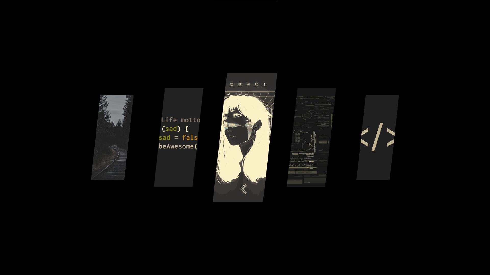

# ⚡ Windows Wallpaper Switcher (0ms Resident Engine)

An ultra-responsive, memory-resident 3D Cover-Flow wallpaper switcher for Windows inspired by Linux customization environments (like Hyprland and Sway). By loading entirely into your system's memory tracks on boot, it achieves a true **0ms instant response time** when triggered.

---

## 📸 Visual Preview



---

## 🔥 Key Architectural Features

- **🚀 0ms Instant Response:** Unlike heavy standard applications, this tool runs as a headless resident memory engine. The exact millisecond you press the keys, it flips a visibility flag rather than initializing a process from scratch.
- **🎬 Aggressive Kinetic Intro:** Driven by a custom hardware-accelerated transformation matrix utilizing a high-velocity `OutExpo` velocity profile. Panels erupt forward from 4.5x scale down to the layout boundaries instantly.
- **⚡ Anti-Aliased Vector Shapes:** Uses custom canvas drawing paths (`QPainter`) to clip images strictly into flat-edged, razor-sharp parallelograms with full pixel-smoothing to prevent jagged lines.
- **📁 Smart Memory Pre-Caching:** All image transformations, center-cropping, and asset loading are performed exactly once on startup to protect your CPU cycles and keep performance lightning fast.

---

## 🛠️ Installation & Setup

### 1. Install System Dependencies
Open your command prompt or terminal shell and install the native global background shortcut hook:
```bash
pip install keyboard PyQt6
```

### 2. Prepare Your Wallpapers Folder
Place your high-resolution wallpaper images (`.jpg`, `.png`, or `.webp`) inside your standard Windows Pictures directory path:
```text
C:\Users\<YourUsername>\Pictures\Wallpapers
```

### 3. Run the Background Service
Launch the resident script execution engine:
```bash
python coverflow_switcher.py
```
*The application will immediately load into your RAM tracks and hide itself silently in the background, consuming nearly 0% CPU cycles.*

---

## ⌨️ How to Control It

- **`Alt + W`** — Instant explosive breach overlay launch from any active workspace window screen.
- **`Mouse Scroll Wheel`** — Seamless carousel deck navigation loops to spin files left and right.
- **`Left-Click Card`** — Force Windows to apply the original high-res image as your wallpaper instantly and hide the overlay.
- **`Esc Key`** — Dismiss the menu layout safely back to background sleep mode.
